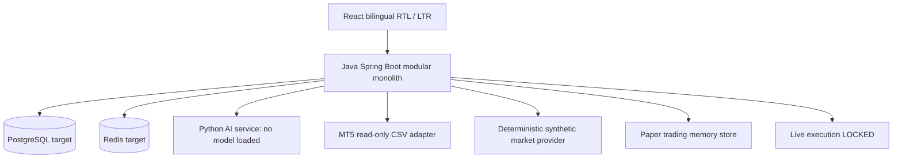

# TradeYar Architecture — version 0.2 (development scaffold)

## Final architectural direction

- Java 21 + Spring Boot modular monolith: domain code and HTTP adapters separated by package, one deployable backend.
- React/TypeScript SPA: `fa-IR` default, RTL for Persian and LTR for English, explicit language switch.
- Python/FastAPI: isolated ML/analytics service; not trusted to authorize trades.
- MT5/MQL5: read-only agent for market snapshots. No live trading or credential storage in source.
- PostgreSQL: target relational store for accounts, market bars, strategy definitions, journals, orders and events.
- Redis: optional caching and async/event distribution in later iterations.
- Shared governance: API contracts, timestamps in UTC, data provenance, request validation, tests, logging, metrics.

## Component diagram

## Security and execution boundary

All order-sending mechanisms are LOCKED. `/api/live/orders` returns HTTP 423 regardless of settings. Paper trading is simulated with synthetic quotes, never forwarded to a broker. No module may bypass an independent risk gate in a future live execution implementation. Human authorization, user authentication, broker-side constraints, idempotency keys, kill-switch, reconciliation and compliance review are prerequisites to enabling execution.

## Layering and dependency direction

Frontend -> REST backend -> application/domain services -> ports -> external adapters.
Backend -> Python AI / MT5 local file / future market data provider.
M10 signals may depend on M08 strategies, but execution must NEVER depend directly on unvalidated AI predictions.
M12 paper trading is isolated from M20 live execution.

## Persistence and maturity

The produced implementation is a runnable **development scaffold**. Market data is deterministic and SYNTHETIC, account preferences / alerts / simulated orders are currently stored in process memory; the PostgreSQL and Redis Docker services are provisioned but not integrated into the application layer. Restarting the backend clears temporary state. Live broker feed, real historical backtests, production auth, persistent journal, trained AI, alerts delivery, and real order submission are NOT implemented.

## Module identifiers

M01 core | M02 UI/i18n | M03 users/preferences | M04 market data | M05 charts | M06 MT5 read-only bridge | M07 technical analysis | M08 strategy engine | M09 backtest | M10 signals | M11 risk | M12 paper trading | M13 journal | M14 news/calendar | M15 AI bridge | M16 alerts | M17 reports | M18 education | M19 infrastructure | M20 live execution (LOCKED).

## Phase acceptance

0 architecture docs; 1 backend baseline and infrastructure; 2 bilingual UI; 3 user preferences; 4 market+chart; 5 MT5 snapshot; 6 indicators+strategies; 7 backtest; 8 signals+risk; 9 paper+journal; 10 news+AI+alerts+reporting+education; 11 explicit live lock.

## Next production implementation slices

1. Persistent schemas and repository ports, Flyway migrations and transaction isolation.
2. Authentication/authorization (non-demo), secret management, audit log, retention policies.
3. Broker adapter with signed command channel, quote freshness, trading hours, lot/pip conversion and risk limits.
4. Historical verified data, realistic cost/slippage simulation, walk-forward tests and backtest reproducibility.
5. Observability: structured logs, tracing, metrics, alerting and disaster recovery.